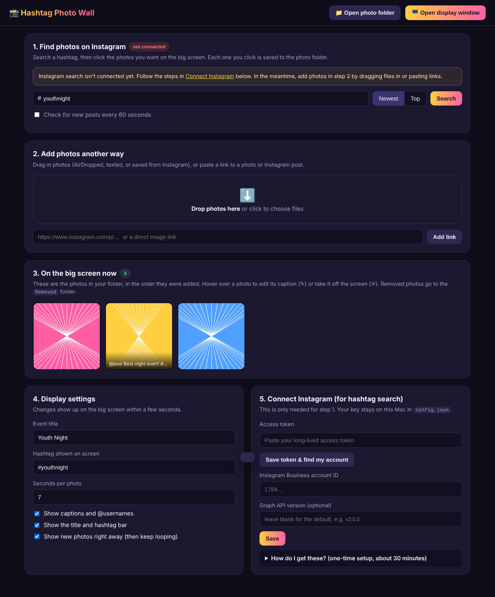
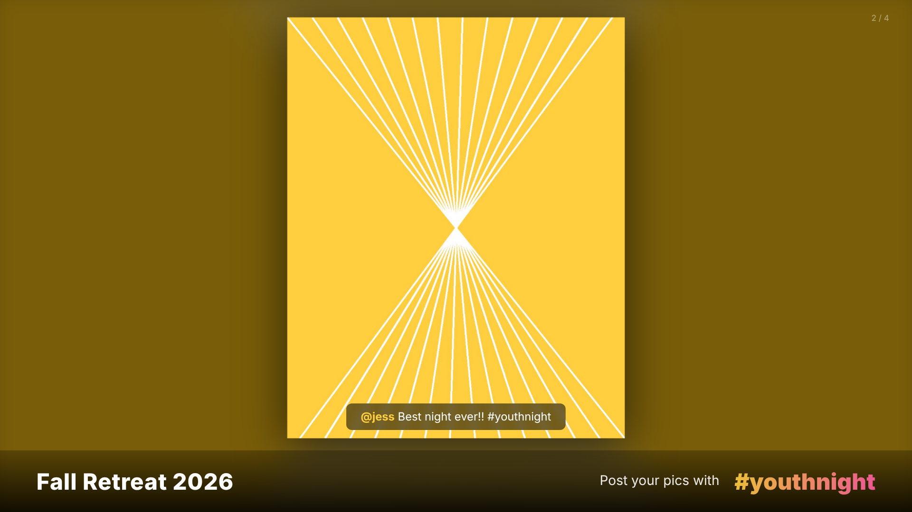

# 📸 Hashtag Photo Wall

Show your group's Instagram photos on a projector or TV during an event.
You choose every photo, so nothing appears on the big screen unless you approve it.

**How it works**
1. Search a hashtag (like `#youthnight`) on your laptop and click the photos you like.
2. Each photo you click is saved in the `ApprovedPhotos` folder.
3. The display window on the extended screen picks up new photos within a few seconds and fades through them in a slideshow.

| Control panel (your laptop) | Display (projector / TV) |
|---|---|
|  |  |

You can also drag in photos people AirDrop or text you, paste a link, or drop files straight into the `ApprovedPhotos` folder in Finder.

---

## Start it on your Mac

1. Download this folder (on GitHub: **Code → Download ZIP**, then unzip it).
2. Double-click **`start.command`**.
   - The first time, macOS may say it can't verify the file. **Right-click `start.command` → Open → Open.** You only need to do this once.
   - If you're asked to install Python, get it from <https://www.python.org/downloads/macos/>.
3. The control panel opens in your browser at **http://localhost:8765**.
   Keep the black Terminal window open while the event is running.

## Put it on the extended screen

1. Connect the projector or TV and make sure it's set to **extend** your display (System Settings → Displays → choose "Extended display", not "Mirror").
2. In the control panel, click **🖥️ Open display window**.
3. Drag that new window onto the projector or TV.
4. Click inside it and press **F** to go full screen.
5. Run the event from the control panel on your laptop. The audience only sees the slideshow.

Tip: turn on Do Not Disturb so notifications don't pop up, and in System Settings → Lock Screen, set the screen to never turn off while on power.

## Getting photos in

| Way | Setup needed | Notes |
|---|---|---|
| **Drag & drop** photos into the control panel | None | Best fallback. Collect photos by AirDrop, text, or a shared album. |
| **Drop files into `ApprovedPhotos`** in Finder | None | They show on screen automatically. |
| **Paste a link** | None | Works with direct image links. Instagram post links work when Instagram lets you see the post without logging in, which is often not the case. If it fails, save the photo and drag it in. |
| **Hashtag search** | One-time Instagram/Meta setup | Real hashtag search with Instagram's official API. See below. |

## Connect Instagram hashtag search (one-time)

Instagram only allows hashtag search through its official API. Requirements:

- An Instagram **Professional** account (Business or Creator), such as your youth group's account.
- That account linked to a **Facebook Page**.
- A free **Meta developer app** with access to the *Instagram Public Content Access* feature (Meta may ask you to submit it for App Review).

The step-by-step guide is in the control panel under **5. Connect Instagram → "How do I get these?"**.
In short: create a Business app at developers.facebook.com, generate a token in the Graph API Explorer, extend it to about 60 days in the Access Token Debugger, paste it into the app, and click **Save token & find my account**.

Limits from Instagram:
- 30 different hashtags per 7 days (searching the same hashtag again doesn't count).
- Only public **photos** are shown; videos are skipped. For multi-photo posts, each photo is shown separately.
- Posts from the last 24 hours appear under **Newest**, and popular posts under **Top**.
- The token expires after about 60 days, so make a new one before your next event.

## Display settings

From the control panel, you can change these and they update on the big screen within seconds:
- Event title, and the hashtag shown on screen
- Seconds per photo
- Show or hide captions and @usernames
- Show or hide the title bar
- Show new photos right away, then keep looping through all of them

Removed photos are moved to `ApprovedPhotos/Removed`, not deleted.

## Files

```
HashtagPhotoWall/
├── start.command        double-click to run (Mac)
├── server.py            the app (Python 3, no extra installs)
├── static/control.html  control panel (your laptop)
├── static/display.html  slideshow (projector / TV)
├── ApprovedPhotos/      your approved photos
├── settings.json        created automatically (display settings)
└── config.json          created automatically (your Instagram token stays on your Mac)
```

Running without the launcher: `python3 server.py` (add `--no-browser` to skip opening the browser).
